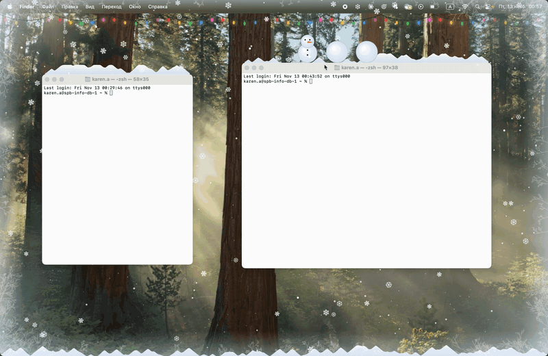

# Snow — снег поверх рабочего стола (macOS / Windows)

Прозрачное окно-оверлей на Electron + TypeScript: снежинки падают поверх всех окон
на каждом мониторе, клики проходят насквозь.



## Возможности

- **Сугробы** копятся на кромках окон, Dock или панели задач и едут вместе с окном.
- **Курсор:** варежка смахивает снег, лопата сгребает его в кучу, из снега можно скатать снежки и снеговика.
- **Погода:** лёгкий снег, ровный, метель, оттепель; ветер: штиль, порывистый, влево, вправо.
- **Украшения:** звёздочки-снежинки, иней по краям экрана, гирлянда.
- **Снегоуборочная машина** сама расчищает низ экрана.

## Запуск

Нужен Node.js 22 или новее.

```bash
npm install
npm start
```

На macOS при сборке компилируется нативный помощник (`native/window-tracker.swift`, нужен
`xcode-select --install`). Без него всё работает, но сугробы отстают от перетаскиваемых окон.
Чтобы снег лежал на самом Dock, выдайте программе, из которой запускаете Snow, разрешение
«Универсальный доступ».

## Управление

Иконка снежинки в меню-баре (macOS) или трее (Windows) открывает настройки. Пауза —
`Cmd/Ctrl + Alt + Shift + S`. Настройки сохраняются между запусками.

## Разработка

```bash
npm test            # типы и тесты
npm run lint        # ESLint
npm run format      # Prettier
npm run dist        # установщик в release/ (.dmg на macOS, .exe на Windows)
npm run profile     # замер CPU и памяти (отчёт profile.json)
```

CI (`.github/workflows/ci.yml`) проверяет проект на macOS и Windows. Релиз собирается по тегу
`v*` (`npm version patch && git push --follow-tags`) и публикует `.dmg` и `.exe` в GitHub Releases.
Приложение не подписано: при первом запуске ОС покажет предупреждение.

## Ограничения

- Слежение за окнами в Windows (PowerShell + WinAPI) на живой системе не проверялось.
- Некоторые программы держат невидимые служебные окна — над ними может вырасти сугроб «в воздухе».
